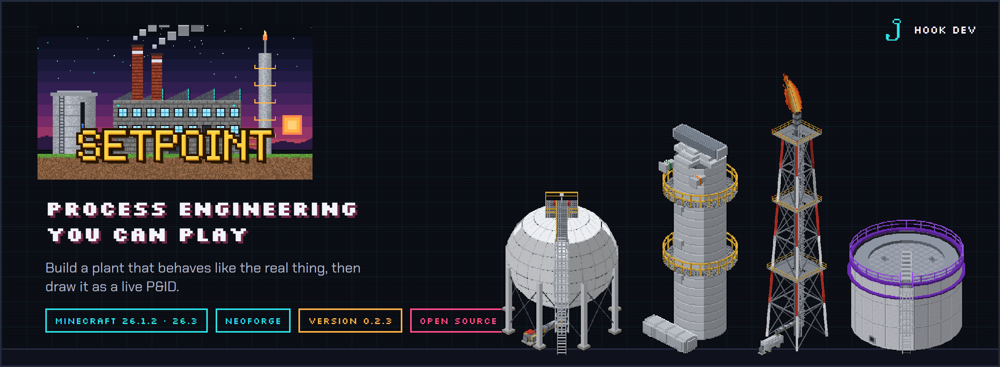
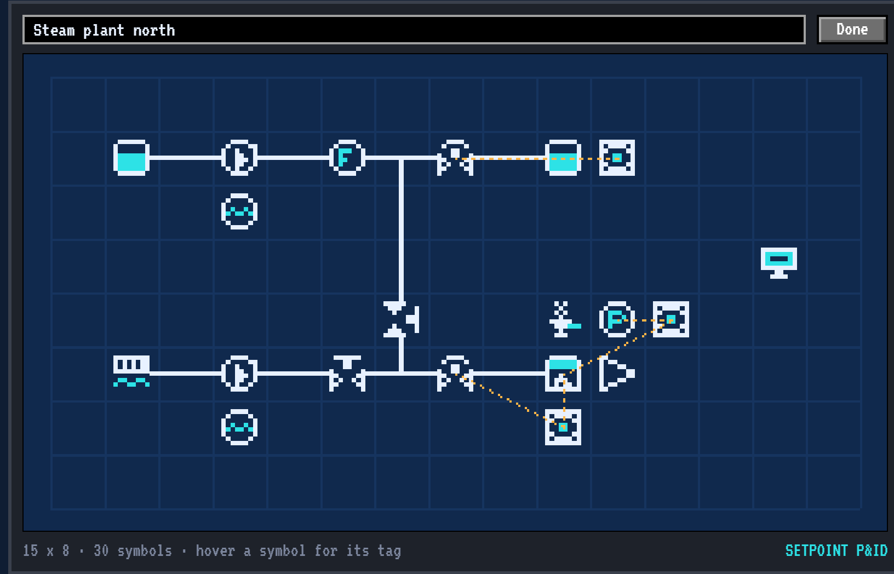
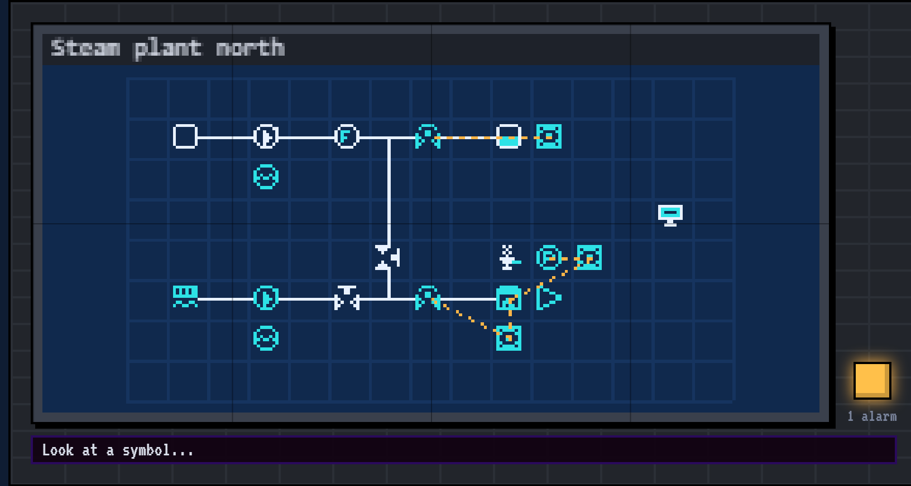
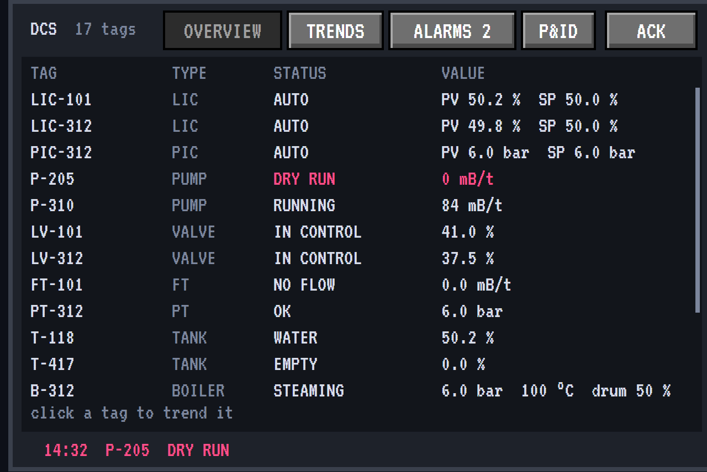
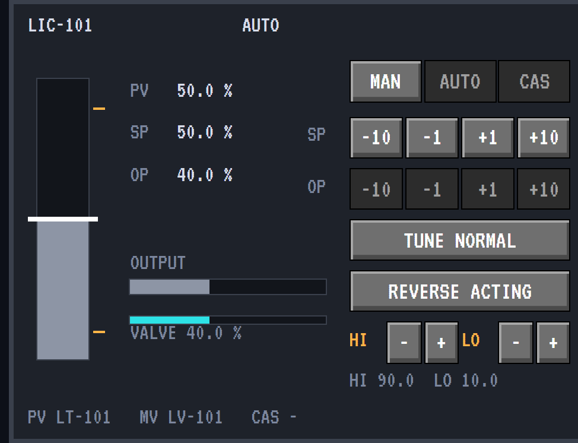
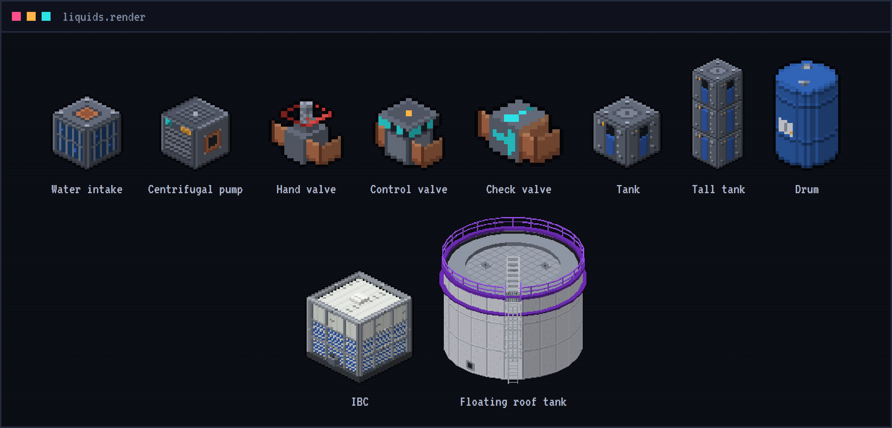
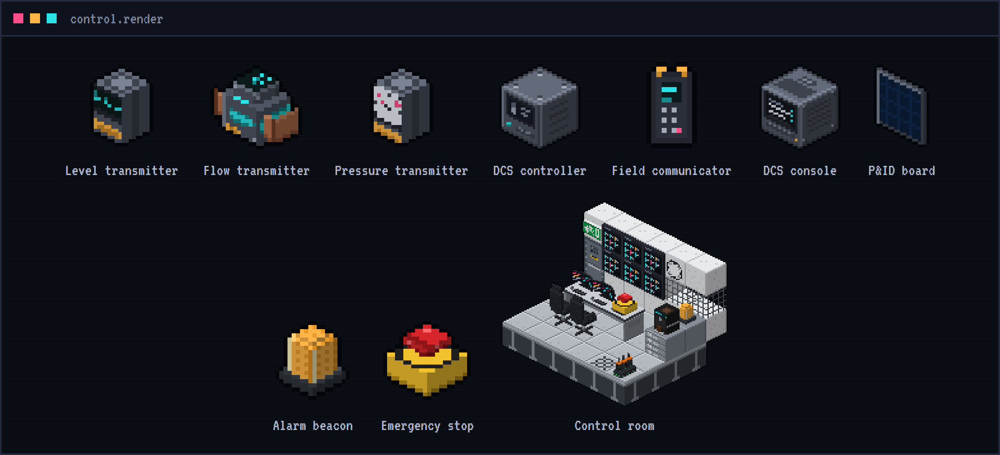
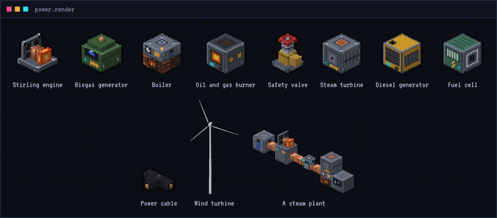
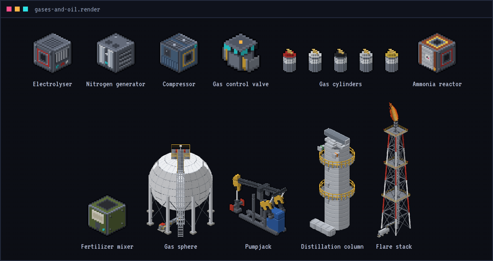
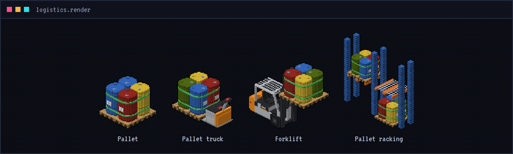

<p align="center">
  
</p>

<p align="center">
  <a href="https://github.com/ParadiseArchive/setpoint/actions/workflows/build.yml"></a>
  
  
  
  <a href="LICENSE"></a>
</p>

<p align="center">
  <a href="https://hookdev.io/projects/minecraft-mods/setpoint/"><b>Read the docs</b></a> &nbsp;·&nbsp;
  <a href="https://hookdev.io/projects/minecraft-mods/"><b>Devlog</b></a> &nbsp;·&nbsp;
  <a href="https://hookdev.io"><b>hookdev.io</b></a>
</p>

---

Setpoint is a Minecraft mod built on real process engineering. Pumps, tanks, control valves and controllers behave
like the real thing: starve a pump and it cavitates, put a controller against a tank and it holds the level by
itself. Build a plant, run it from a control room, and draw it as a real P&ID.

**Easy by default, real physics underneath.** Things link up and set themselves up, so any player can build a working
plant. The depth is there for those who want it: pump curves, pressure, gravity, every liquid with its own weight.

## The heart of it: P&IDs

A P&ID (piping and instrumentation diagram) is the map of a real process plant. Every operator learns to read one.
In Setpoint you draw your own, straight from what you built.

1. Right-click the ground with a **blank P&ID**: the first corner.
2. Look at the opposite corner. The box shows in the world, ten blocks high.
3. Right-click it. Your plant comes out as a P&ID: every pump, tank, valve and instrument as its symbol, with the
   pipes and signal lines between them.

Then put it to work. Right-click a DCS console with it and the drawing goes **live**: running equipment turns cyan,
tanks fill up to their real level, alarms flash. Or hang it big on the wall on a **P&ID board** and run the plant from
there: look at a symbol for its status, click a controller for its faceplate, start and stop the pumps.

<p align="center">
  
  
</p>

## Run it from the control room

The DCS console sees every tag in your plant: an overview, trends and an alarm list with ACK. Every controller has a
faceplate like a real DCS: MAN, AUTO and CAS, setpoint and output, alarm limits and tuning. Build the room round it
with a video wall that can show your P&ID live, an amber alarm beacon, a red emergency stop, a console built into a desk,
a printer that prints the alarm log for the shift handover, and a 24-hour chair.

<p align="center">
  
  
</p>

## What you can build

### Liquids
Pipes, tanks that stack into tall tanks, centrifugal pumps with a real pump curve, hand, check, drain and control
valves, gravity flow, drums, IBCs and a floating roof tank of 8000 buckets.



### Control
Level, flow and pressure transmitters, DCS controllers that find their own valve, a field communicator, the DCS
console, P&ID boards and a whole control room.



### Power and steam
From a Stirling engine on coal up to diesel: a biogas generator, a boiler with real steam pressure and a safety
valve, an oil and gas burner that fires it on what your refinery makes, a steam turbine, a diesel generator, a fuel cell
and a wind turbine thirty blocks high. Power cables, cable trays and transformers bring the FE to machines that do not
touch a generator, a battery bank keeps what they leave over, and a power meter shows what flows.



### Gases and oil
Hydrogen, oxygen, nitrogen, ammonia and LPG with real pressure. An electrolyser, a compressor up to 200 bar, gas
cylinders and a gas sphere, gas valves and pressure control valves, an ammonia reactor for fertilizer. A pumpjack and a distillation column that splits crude
into LPG, naphtha, kerosene, diesel and residue. And on top of it all, the tallest thing in the mod: a flare stack
forty blocks high that burns what the plant cannot keep.



### Logistics
Pallets of drums, an electric pallet truck, a forklift and pallet racking. Plus factory blocks to build round it all:
grating, handrails, stairs, caged ladders, steel beams, hazard stripes, concrete plinths and bund walls, an epoxy floor
with walkways, pipe racks, insulated pipes, wall sleeves, safety signs, an MCC cabinet and a local control station. And
Hookonium, a purple endgame ore, for operator gear as strong as diamond: a hard hat, a bump cap, a coverall you can
dye and safety boots.



## Get it

Setpoint **0.2.3** is the latest release. Back up your world before you update to a new version.
Download it on **[CurseForge](https://www.curseforge.com/minecraft/mc-mods/setpoint)**, or build it yourself (see below).

- Minecraft 26.3 or 26.1.2 (the version of All the Mods 11) with NeoForge, Java 25: pick the file for your Minecraft version
- In-game help: the **Setpoint Handbook**, tooltips (hold Shift for more) and advancements
- `/setpoint showcase` builds a working example plant next to you (creative or cheats; best in a superflat world)
- Works with JEI (a tab for every machine), Jade, other mods' tanks, and other mods' steam (c:steam)

The full documentation, with every machine, recipe and screen, is on
**[hookdev.io](https://hookdev.io/projects/minecraft-mods/setpoint/)**.

## Building

```
./gradlew build               # jar for Minecraft 26.3 in build/libs
./gradlew build -Pmc=26.1     # jar for Minecraft 26.1.2 in build-26.1/libs (see versions/README.md)
./gradlew runClient           # start a development client
./gradlew runGameTestServer   # run the automated in-game tests
```

Every push is built and tested by GitHub Actions. The pictures in this README come from `tools/readme-art.mjs`.

## License

MIT, see [LICENSE](LICENSE). Built on the NeoForge MDK (see TEMPLATE_LICENSE.txt).
Minecraft names used in code come from Mojang's official mappings, see https://github.com/NeoForged/NeoForm/blob/main/Mojang.md.

<sub>NOT AN OFFICIAL MINECRAFT PRODUCT. NOT APPROVED BY OR ASSOCIATED WITH MOJANG OR MICROSOFT.</sub>

<p align="center"><a href="https://hookdev.io"><sub>made by Hook Development</sub></a></p>
